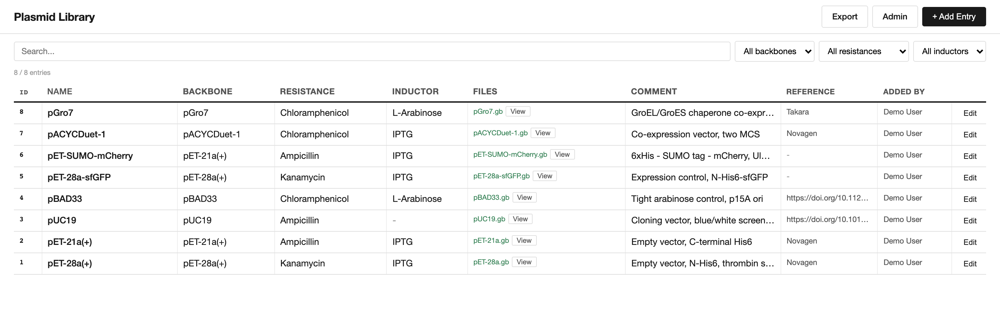

# Plasmid Database

A Flask-based web application for managing laboratory plasmid collections. Stores plasmid records with sequence data in SQLite, supports file uploads for common molecular biology formats, and includes Nagoya Protocol compliance reference information.



## Features

- Browse, search, and filter plasmid records with sortable columns
- Store plasmid metadata: backbone, inductor, antibiotic resistance, references, comments
- Upload and attach sequence files (GenBank, FASTA, SnapGene, ApE, and more)
- Parse sequence files with BioPython for automatic metadata extraction
- Password-protected admin panel for editing and deleting records
- Full audit trail tracking all database changes with timestamps and IP addresses
- Automatic weekly database backups with configurable retention
- HTML export of the full plasmid collection as a printable report
- Nagoya Protocol compliance reference for genetic resource tracking
- Embeddable via iframe for integration with other lab tools

## Requirements

- Python 3.8+
- Flask
- BioPython
- schedule

## Setup

```bash
pip install -r requirements.txt
python plasmid_server.py
```

Or use `START_SERVER.sh` (macOS/Linux) or `START_SERVER.bat` (Windows), which install the requirements if Flask is missing and start the server.

The server starts at `http://localhost:5001`. The admin panel is at `http://localhost:5001/admin`.

Default admin password: `admin123` -- change this in `plasmid_server.py` (line 33) before any real deployment.

## File Structure

```
plasmid_server.py       Main Flask application (single-file server with embedded templates)
requirements.txt        Python dependencies
START_SERVER.sh/.bat    Startup scripts for macOS/Linux and Windows
nagoya-info.md          Nagoya Protocol reference material
uploads/                Uploaded sequence and attachment files (created at runtime)
backups/                Automatic database backups (created at runtime)
plasmid_library.db      SQLite database (created at first run)
```

## Supported File Formats

- GenBank (.gb, .gbk)
- FASTA (.fasta)
- SnapGene (.dna)
- ApE (.ape)
- Plain sequence (.seq)
- Documents (.pdf, .docx, .xlsx)
- Images (.png, .jpg, .gif)

## Configuration

Key settings at the top of `plasmid_server.py`:

- `ADMIN_PASSWORD_HASH` -- admin panel password (default: `admin123`)
- `DB_FILE` -- SQLite database path (default: `plasmid_library.db`)
- `UPLOAD_DIR` -- file upload directory (default: `uploads`)
- `BACKUP_DIR` -- backup directory (default: `backups`)
- `MAX_CONTENT_LENGTH` -- max upload size (default: 50 MB)

## License

MIT
